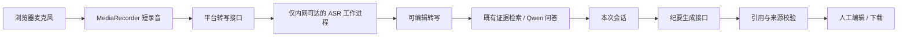

# 知识问答：语音输入与 AI 纪要接入方案

日期：2026-11-08。此文是实施方案，尚未改动问答页面、接口或模型服务。

## 1. 产品范围

第一版把“AI 纪要”定义为**一次知识问答会话的研究纪要**：记录用户提出的问题、人工确认的转写文本、检索到的证据、仍待核查的问题和下一步事项。它不是自动生成病历、诊断或用药建议。多人会议录音、自动区分说话人、长期存档列入后续阶段。

用户路径：

```text
点麦克风 → 录制一句问题 → 停止 → 转写 → 用户校对/修改
       → 检索证据并继续问答 → 点“生成本次纪要”
       → 检查引用和待核实项 → 编辑 → 下载 Markdown/JSON
```

短语音和纪要是两项独立能力：语音转写成功不等于 AI 回答或 AI 纪要已可用。

## 2. 当前基础与附件核对

- 当前 `/knowledge-qa/` 有文本输入、证据检索和来源链接；`POST /api/v1/knowledge-qa` 可以调用内网 Qwen 服务，但当前普通启动实例返回 `LLM_UNAVAILABLE`，前端退回证据列表。问题长度上限为 200 字。
- 当前服务的角色识别是演示身份桩，正式院内认证尚未接入。现有 180 天留存参数面向导入流程，**不沿用到录音**。
- `E:/model.zip` 有 10 个条目，压缩包约 1.31 GB，权重展开约 1.66 GB；配置标识为 `fun_asr_nano`、`FunAsrNanoForConditionalGeneration`，特征提取采样率 16 kHz。压缩包完整性检查通过，条目无路径穿越。
- 该 ZIP 只提供转写模型资产，没有现成 HTTP 服务、VAD、说话人区分、纪要生成器或许可证/来源说明。其结构与 FunASR Nano 的 Transformers 导出路径相符；**具体模型版本和可运行性仍须通过来源、指纹和推理冒烟测试确认**。当前平台 Python 环境没有 `torch`、`transformers` 或 `funasr`。
- 官方 FunASR 文档区分原始 AutoModel、Transformers 导出和 vLLM 转换权重；不能仅改目录名就换推理后端。原生 Transformers 导出本身不提供说话人标记、时间戳或 HTTP 接口。参考：[模型选择](https://github.com/modelscope/FunASR/blob/main/docs/model_selection.md)、[原生 Transformers 路径](https://github.com/modelscope/FunASR/blob/main/docs/transformers_native.md)。

## 3. 页面设计

### 3.1 语音提问

在现有输入框内增加麦克风按钮，不另开一套问答页。按钮依次显示“开始录音 / 录音中·计时 / 停止 / 转写中 / 转写失败·重试”。停止后展示可播放的本次录音和**可编辑的转写预览**；用户点击“采用转写”才把文字放进问题框，点击“检索证据”才发送问题。绝不自动提交识别结果。

第一版单段录音上限建议 60 秒、20 MB；识别文本超过当前 200 字问题上限时提示用户缩短或编辑，不静默截断。麦克风权限拒绝、设备缺失、超时或浏览器不支持时，文本输入保持可用。浏览器通过 `getUserMedia` 和 `MediaRecorder` 录制；院内部署使用 HTTPS，本地 `localhost` 可做联调。浏览器必需用户授权麦克风。参考：[MDN getUserMedia](https://developer.mozilla.org/en-US/docs/Web/API/MediaDevices/getUserMedia)、[MDN MediaRecorder](https://developer.mozilla.org/en-US/docs/Web/API/MediaRecorder)。

### 3.2 本次纪要

在结果区增加“本次问答”抽屉，显示按时间排列的问题、用户确认后的转写、检索证据数和链接。至少有一轮问答后才出现“生成本次纪要”。纪要采用固定结构：

1. 主题与时间、用途标签（研究参考）。
2. 本次问题及讨论要点，标注为“会话记录”，不自动升级为已核实医学事实。
3. 已核对证据：每条事实旁保留 `claim_id`、来源、核对状态和定位。
4. 未找到证据或仍待人工核实的事项。
5. 后续行动：只提取会话里明确提出的事项；负责人和期限未说出时留空。
6. 生成模型、知识库版本、转写模型版本、人工复核状态和研究用途声明。

纪要先展示草稿，允许逐段编辑；用户确认后再下载 Markdown/JSON。第一版不自动发送、不自动入病历，也不在服务端持久保存音频或纪要。页面刷新会丢失未导出的会话，界面提前提示。

## 4. 技术链路与接口



拟增加：

| 接口 | 输入 | 输出与约束 |
|---|---|---|
| `POST /api/v1/knowledge-qa/transcribe` | multipart 音频；单段上限 60 秒、20 MB | `{text, model_version, requires_review:true, duration_ms, status}`；只转写，不提问；服务端识别真实格式、转为 16 kHz 单声道，临时文件在成功/失败后清理。 |
| `POST /api/v1/knowledge-qa/minutes` | 本次会话中**已确认**的问题/转写及引用 ID | 结构化纪要草稿、未核实项、引用、模型版本；服务端按 ID 重新查知识库并检查来源，不信任浏览器传来的证据正文。 |
| `GET /api/v1/knowledge-qa/capabilities` | 无敏感内容 | 返回 ASR、LLM、纪要功能的可用状态，分别控制按钮；不可用时显示具体降级路径。 |

ASR 权重放在独立的模型目录/虚拟环境，由本机或院内 GPU/CPU 工作进程常驻加载，不塞进 Flask 主进程，不把 1.66 GB 权重放进公开静态目录。先按该 ZIP 的实际加载路径做单条中文录音冒烟测试，再选择运行后端和硬件；不预先承诺延迟。长录音需要 VAD、切段、队列和任务状态接口，留到下一阶段。

纪要模型沿用平台现有本地 Qwen 接口，但提示词与普通问答分开。输入是经用户确认的会话内容和服务端重新取出的证据条目。模型输出固定 JSON；后处理拒绝不存在的 `claim_id`，并把“会话中有人说过”与“知识库已核查”分栏。若 Qwen 不可用，只显示可编辑的转写与证据清单，**不伪装成 AI 纪要**。

## 5. 数据边界

- 研究联调阶段只用合成或已授权的去标识音频。现有“千问模式”通过校园服务器 SSH 隧道连接，不视为医院院内服务；未经明确授权的真实病历和临床录音不走这条链路。
- 录音前明确显示“麦克风将被使用”；只在用户点击后采集，停止后立即释放媒体轨道。默认不落盘、不上传第三方云服务；转写请求只到平台同源接口。
- 服务端限制音频大小、时长、MIME 与真实文件格式，设置超时和并发上限；请求日志与审计只记操作者、时间、时长、状态、模型版本和引用数量，不记原音、转写正文或患者信息。
- 正式院内部署前接入 SSO、HTTPS、访问控制、独立音频留存策略及删除机制。纪要仍带“研究参考 / 人工复核 / 不用于临床决策”。

## 6. 分阶段交付与验收

**P0 模型验证**：核对 `model.zip` 来源/许可/哈希；隔离环境安装匹配的 Transformers 与音频依赖；在中文、英语及 NIHSS、SeLECT、EEG、D13 等术语样本上记录识别结果、人工修改量、首轮/稳态延迟和内存占用。根据实测决定 CPU 或 GPU。此阶段不接真实录音。

**P1 语音提问**：完成麦克风交互、转写接口和人工校对；文本检索原流程不变。验收覆盖权限拒绝、设备缺失、空白/超长音频、格式伪装、网络中断、重复点击、200 字边界和临时文件清理。

**P2 会话纪要**：多轮问答形成纪要草稿，人工修改、引用校验和 Markdown/JSON 导出；测试无证据、错误证据 ID、模型离线、转写中医学术语被改错、会话中未指定负责人等情况。生成结果须能追到会话条目或知识库 claim，不能凭空增加治疗建议。

**P3 视需求扩展**：多人会议长录音、VAD 切段、时间戳、说话人分离、院内留存和 PDF 导出。当前 ZIP 不足以单独实现这些能力，需另选组件并重新验收。

上线判断以 P0 的本机/院内硬件实测、医学术语人工复核结果、引用准确率、降级行为和数据流审计为准；不把模型下载成功当作功能完成。
